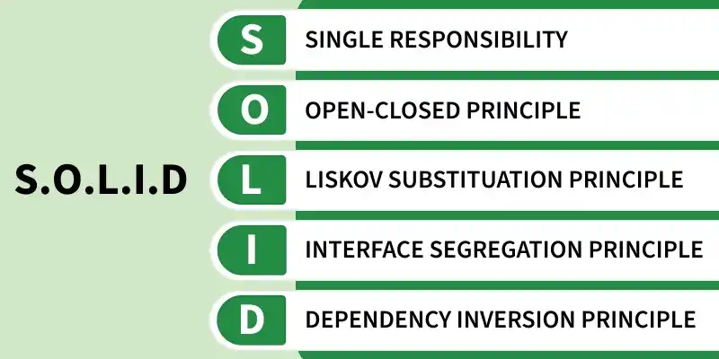

# SOLID Principles in Python

## Introduction

**SOLID** is a set of five design principles for object-oriented programming, popularized by **Robert C. Martin (Uncle Bob)**. Following them makes software **easier to understand, maintain, extend, and test**.

| Letter | Principle | One-line meaning |
|--------|-----------|------------------|
| **S** | Single Responsibility Principle (SRP) | A class should have only one reason to change |
| **O** | Open/Closed Principle (OCP) | Open for extension, closed for modification |
| **L** | Liskov Substitution Principle (LSP) | Subclasses must be usable wherever the parent class is expected |
| **I** | Interface Segregation Principle (ISP) | No class should be forced to implement methods it does not use |
| **D** | Dependency Inversion Principle (DIP) | Depend on abstractions, not on concrete classes |

### Why do we need SOLID?

- Avoids **tight coupling** and **rigid / fragile code**
- Makes code **reusable** and **readable**
- Makes **unit testing** and mocking easy
- Reduces the **risk of bugs** when requirements change
- Helps teams work on different parts of the code without conflicts

---

## 1. Single Responsibility Principle (SRP)

> **Definition:** A class should have **only one reason to change**, i.e. it should do one job only.

If a class handles multiple concerns (business logic + database + email + formatting), a change in any one of them forces you to touch the same class, which risks breaking the others.

### ❌ Violating SRP

```python
class Invoice:
    def __init__(self, items):
        self.items = items

    def calculate_total(self):          # business logic
        return sum(i["price"] * i["qty"] for i in self.items)

    def save_to_db(self):               # persistence
        print("Saving invoice to database...")

    def send_email(self, to):           # notification
        print(f"Emailing invoice to {to}")
```

`Invoice` changes if tax rules change, **or** if the DB changes, **or** if the email provider changes - three reasons to change.

### ✅ Following SRP

```python
class Invoice:
    def __init__(self, items):
        self.items = items

    def calculate_total(self):
        return sum(i["price"] * i["qty"] for i in self.items)


class InvoiceRepository:
    def save(self, invoice: Invoice):
        print("Saving invoice to database...")


class EmailService:
    def send(self, to: str, invoice: Invoice):
        print(f"Emailing invoice to {to}")
```

**Benefits:** small focused classes, easier testing, fewer merge conflicts.

---

## 2. Open/Closed Principle (OCP)

> **Definition:** Software entities (classes, modules, functions) should be **open for extension** but **closed for modification**.

You should be able to add **new behaviour** by writing **new code**, not by editing tested, working code. Typical tools: **inheritance, abstract classes, polymorphism, strategy pattern, configuration**.

### ❌ Violating OCP

```python
class DiscountCalculator:
    def calculate(self, customer_type, amount):
        if customer_type == "regular":
            return amount * 0.05
        elif customer_type == "premium":
            return amount * 0.10
        elif customer_type == "vip":          # new type => edit this method again
            return amount * 0.20
```

Every new customer type forces a **modification** of `calculate()`.

### ✅ Following OCP

```python
from abc import ABC, abstractmethod


class Discount(ABC):
    @abstractmethod
    def apply(self, amount: float) -> float: ...


class RegularDiscount(Discount):
    def apply(self, amount): return amount * 0.05

class PremiumDiscount(Discount):
    def apply(self, amount): return amount * 0.10

class VIPDiscount(Discount):                  # extension only - no existing code touched
    def apply(self, amount): return amount * 0.20


class DiscountCalculator:
    def calculate(self, discount: Discount, amount: float) -> float:
        return discount.apply(amount)


print(DiscountCalculator().calculate(VIPDiscount(), 1000))   # 200.0
```

**Tip:** "Make everything **configurable**" - move changing behaviour into config / new classes instead of `if-else` chains.

---

## 3. Liskov Substitution Principle (LSP)

> **Definition:** Objects of a **derived (child) class** must be able to **replace objects of the base (parent) class** without breaking the correctness of the program.

(Introduced by **Barbara Liskov**, 1987.) A child class must **honour the contract** of its parent: same method signatures, no stronger preconditions, no weaker postconditions, no unexpected exceptions.

### ❌ Violating LSP (classic Bird example)

```python
class Bird:
    def fly(self):
        print("Flying")

class Sparrow(Bird):
    pass

class Penguin(Bird):
    def fly(self):
        raise Exception("Penguins can't fly!")    # breaks the parent's contract


def make_it_fly(bird: Bird):
    bird.fly()

make_it_fly(Sparrow())   # OK
make_it_fly(Penguin())   # 💥 crashes - Penguin is not a safe substitute for Bird
```

### ✅ Following LSP

```python
class Bird:
    def eat(self):
        print("Eating")

class FlyingBird(Bird):
    def fly(self):
        print("Flying")

class Sparrow(FlyingBird):
    pass

class Penguin(Bird):          # no fly() promised, so nothing is broken
    def swim(self):
        print("Swimming")


def make_it_fly(bird: FlyingBird):
    bird.fly()

make_it_fly(Sparrow())        # OK - Penguin can't even be passed here
```

### Another classic: Rectangle / Square

`Square(Rectangle)` overriding `set_width` to also change height breaks code that assumes width and height are independent. **Fix:** don't model it as inheritance, or use a common `Shape` abstraction with `area()`.

### Signs of LSP violation
- Child overrides a method just to `raise NotImplementedError` / do nothing
- `isinstance()` checks needed before using a subclass
- Child narrows accepted input or changes return type semantics

---

## 4. Interface Segregation Principle (ISP)

> **Definition:** Clients should **not be forced to depend on methods they do not use**. Prefer **many small, specific interfaces** over one large "fat" interface.

### ❌ Violating ISP

```python
from abc import ABC, abstractmethod

class Machine(ABC):
    @abstractmethod
    def print(self, doc): ...
    @abstractmethod
    def scan(self, doc): ...
    @abstractmethod
    def fax(self, doc): ...

class OldPrinter(Machine):
    def print(self, doc): print("Printing", doc)
    def scan(self, doc): raise NotImplementedError   # forced to implement
    def fax(self, doc): raise NotImplementedError    # forced to implement
```

### ✅ Following ISP

```python
from abc import ABC, abstractmethod

class Printer(ABC):
    @abstractmethod
    def print(self, doc): ...

class Scanner(ABC):
    @abstractmethod
    def scan(self, doc): ...

class FaxMachine(ABC):
    @abstractmethod
    def fax(self, doc): ...


class OldPrinter(Printer):
    def print(self, doc): print("Printing", doc)

class MultiFunctionPrinter(Printer, Scanner, FaxMachine):
    def print(self, doc): print("Printing", doc)
    def scan(self, doc): print("Scanning", doc)
    def fax(self, doc): print("Faxing", doc)
```

> In Python, `typing.Protocol` can also be used for small, structural interfaces (duck typing with type checking).

**Benefits:** low coupling, no dummy methods, easy to mock in tests.

---

## 5. Dependency Inversion Principle (DIP)

> **Definition:**
> 1. **High-level modules** should not depend on **low-level modules**. Both should depend on **abstractions**.
> 2. **Abstractions** should not depend on details. **Details** should depend on abstractions.

DIP suggests classes should rely on **abstractions** (interfaces / abstract classes) rather than **concrete implementations**.

> ⚠️ **DIP ≠ Dependency Injection.** DIP is the *principle*; Dependency Injection (DI) is a *technique* used to achieve it (see `DI.md`).

### ❌ Violating DIP

```python
class MySQLDatabase:
    def save(self, data):
        print("Saving to MySQL:", data)

class UserService:                       # high-level
    def __init__(self):
        self.db = MySQLDatabase()        # hard-coded low-level dependency

    def register(self, user):
        self.db.save(user)
```

Switching to PostgreSQL / MongoDB, or mocking in tests, requires editing `UserService`.

### ✅ Following DIP

```python
from abc import ABC, abstractmethod

class Database(ABC):                     # abstraction
    @abstractmethod
    def save(self, data): ...

class MySQLDatabase(Database):           # low-level detail
    def save(self, data): print("Saving to MySQL:", data)

class MongoDatabase(Database):           # low-level detail
    def save(self, data): print("Saving to MongoDB:", data)


class UserService:                       # high-level depends on abstraction
    def __init__(self, db: Database):    # injected from outside
        self.db = db

    def register(self, user):
        self.db.save(user)


UserService(MySQLDatabase()).register("mahesh")
UserService(MongoDatabase()).register("mahesh")
```

**Testing becomes trivial:**

```python
class FakeDB(Database):
    def __init__(self): self.saved = []
    def save(self, data): self.saved.append(data)

fake = FakeDB()
UserService(fake).register("test")
assert fake.saved == ["test"]
```

```
Before:  UserService ───────────▶ MySQLDatabase
After:   UserService ──▶ Database (abstraction) ◀── MySQLDatabase
```

---

## How the Principles Work Together

| Principle | Mainly fights against |
|-----------|----------------------|
| SRP | God classes / multiple reasons to change |
| OCP | Long `if-elif` chains, editing tested code |
| LSP | Broken inheritance hierarchies |
| ISP | Fat interfaces, dummy method implementations |
| DIP | Tight coupling to concrete classes |

- **SRP + ISP** → small, focused classes and interfaces
- **OCP + LSP** → safe extension through polymorphism
- **DIP** → glues everything together via abstractions

---

## Quick Summary / Cheat Sheet

1. **SRP** - one class, one job.
2. **OCP** - add new code, don't change old code.
3. **LSP** - child must behave like its parent.
4. **ISP** - small interfaces, no unused methods.
5. **DIP** - depend on abstractions, inject dependencies.

## Advantages
- Maintainable and readable code
- Easy to extend and test
- Loosely coupled, reusable components
- Fewer bugs when requirements change

## Disadvantages / Cautions
- Can lead to **over-engineering** (too many small classes) for small scripts
- Slightly more initial design effort
- Apply when there is a real need - don't abstract "just in case" (balance with **KISS** and **YAGNI**)

## Interview Questions

1. **What is SOLID?** Five OOP design principles for maintainable, extensible software.
2. **Difference between DIP and Dependency Injection?** DIP is a design principle (depend on abstractions); DI is a technique to supply those dependencies from outside.
3. **How do you achieve OCP in Python?** Abstract base classes, polymorphism, strategy pattern, decorators, configuration/registry.
4. **Give an LSP violation example.** `Penguin(Bird)` raising an exception in `fly()`; `Square(Rectangle)`.
5. **How is ISP different from SRP?** SRP is about a *class* having one reason to change; ISP is about *interfaces* not forcing unused methods on clients.
6. **Which principle makes unit testing easier?** DIP (mockable abstractions) along with SRP.
7. **How can you spot an SRP violation?** The class name contains "And"/"Manager"/"Handler" doing many things, or it changes for unrelated reasons.
