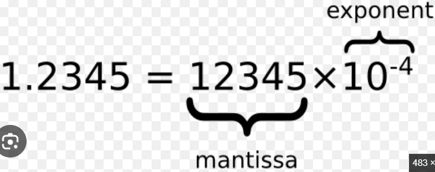

# LLM Inference – Complete Guide

Related notes: [[55.0.llm_training_to_inference_overview.md]] (how the model is trained), [[28.llm_architecture.md]] (transformer internals), [[40.llm_parameters_tokens_and_cost.md]] (sampling parameters and pricing), [[53.inference_cost_reduction.md]] (reducing cost), [[54.vllm.md]] (serving engine).

**Table of Contents**

1. What is LLM Inference?
2. Training vs Inference
3. Key Terms You Should Know
4. How LLM Inference Works (Step by Step)
5. Phases of Inference: Prefill and Decode
6. KV Cache in Detail
7. Decoding Strategies
8. Stopping Conditions
9. Performance Metrics
10. Memory Requirement of an LLM
11. Batching
12. Optimization Techniques
13. Ways to Run LLM Inference
14. Online vs Offline Inference
15. Inference for Other Model Types
16. Challenges in LLM Inference
17. Practical Code Examples
18. Interview Questions

---

## 1. What is LLM Inference?

**LLM inference** is the process of using an already trained Large Language Model to generate an output (text, code, a classification, an embedding) for a new input given by a user.

Whenever you type a question in a chatbot and get an answer, the model is performing inference. The model does not learn anything new during this process. It only uses the knowledge that is already stored in its **weights** (parameters).

In simple words:

> **Training** = the model studies and learns.
> **Inference** = the model answers an exam question using what it has already learned.

A trained LLM is just a very large file of numbers (billions of weights). Inference means loading those numbers into GPU memory and doing mathematical operations on them to turn the input tokens into output tokens.

---

## 2. Training vs Inference

| Feature | Training | Inference |
|---|---|---|
| Purpose | Learn the weights | Use the weights to generate output |
| Passes | Forward pass + backward pass | Forward pass only |
| Weights | Updated continuously | Frozen (never change) |
| Data | Huge dataset with known answers | One user prompt, answer unknown |
| Memory used | Weights + gradients + optimizer states + activations | Weights + KV cache |
| Frequency | Done once (or occasionally) | Done for every user request |
| Cost | Very high, but one-time | Smaller per request, but keeps growing with traffic |
| Hardware | Large GPU clusters | One or a few GPUs per replica |
| Main goal | Minimise loss | Minimise latency and cost, maximise throughput |

**Important point:** For a product used by millions of people, the total money spent on inference over time is usually much more than the money spent on training. That is why inference optimisation is a major topic.

---

## 3. Key Terms You Should Know

| Term | Meaning |
|---|---|
| **Token** | A small piece of text (a word, part of a word, or a symbol). The model reads and writes tokens, not characters. Roughly 1 token ≈ 4 characters or ¾ of an English word. |
| **Tokenizer** | Converts text to token IDs and token IDs back to text. |
| **Vocabulary** | The set of all tokens the model knows (usually 32K to 256K entries). |
| **Prompt** | The full input given to the model (system instructions + chat history + user question). |
| **Context window** | Maximum number of tokens (prompt + output) the model can handle at one time. |
| **Logits** | The raw scores the model gives to every token in the vocabulary for the next position. |
| **Autoregressive** | Generating one token at a time, where each new token depends on all previous tokens. |
| **KV cache** | Stored Key and Value vectors of previous tokens, reused to avoid recomputation. |
| **TTFT** | Time To First Token. |
| **TPOT / ITL** | Time Per Output Token / Inter-Token Latency. |
| **Throughput** | Total number of tokens generated per second across all users. |

---

## 4. How LLM Inference Works (Step by Step)

An LLM generates text **one token at a time**. The output token is added to the input, and the whole process repeats.

```
Prompt  ──► Tokenize ──► Embed ──► Transformer layers ──► Logits ──► Softmax
                                                                       │
                       ┌───────────────────────────────────────────────┘
                       ▼
                 Pick next token ──► Append to sequence ──► repeat until stop
```

### Step 1: Build the prompt
The application combines the system prompt, previous messages, and the new user question using the model's **chat template**.

```
<system> You are a helpful assistant
<user> What is the capital of France?
<assistant>
```

The model does not see this as a "question". It sees it as text and its job is to predict what comes next after `<assistant>`.

### Step 2: Tokenization
The text is split into tokens and each token is mapped to an integer ID.

```
"What is the capital of France?"  →  [3923, 374, 279, 6864, 315, 9822, 30]
```

### Step 3: Embedding
Each token ID is converted into a vector of numbers (for example 4096 numbers) by looking it up in the **embedding matrix**. Position information is added so the model knows the order of tokens.

### Step 4: Transformer layers
The vectors pass through N stacked transformer blocks (for example 32 blocks in an 8B model). Each block has:
- **Self-attention** – every token looks at earlier tokens and collects useful information from them.
- **Feed-forward network (FFN)** – processes each token's vector further.
- **Residual connections and normalisation** – keep training and computation stable.

(Details are in [[28.llm_architecture.md]].)

### Step 5: Output layer (logits)
The final vector of the **last token** is multiplied with the output matrix. This gives one score (logit) for every token in the vocabulary.

### Step 6: Softmax
Softmax converts logits into probabilities that add up to 1.

```
"Paris"  → 0.82
"The"    → 0.06
"France" → 0.03
...
```

### Step 7: Select the next token
One token is chosen from this distribution using a **decoding strategy** (greedy, temperature sampling, top-k, top-p).

### Step 8: Append and repeat
The chosen token is added to the sequence and Steps 3 to 7 are repeated (now only for the new token, thanks to the KV cache) until a stop condition is reached.

### Step 9: Detokenize and return
All generated token IDs are converted back to text and sent to the user, usually **streamed** token by token.

**Key point:** The model never "looks up" an answer from a database. It predicts the most suitable next token again and again, and the full answer is the result of many such predictions.

---

## 5. Phases of Inference: Prefill and Decode

LLM inference is divided into two phases that behave very differently.

### 5.1 Prefill Phase (Prompt Processing)
- The **entire prompt** is processed in a single forward pass.
- All prompt tokens are computed **in parallel**.
- The Key and Value vectors of every prompt token are calculated and saved in the KV cache.
- The first output token is produced at the end of this phase.
- This phase is **compute-bound**: the GPU is busy doing large matrix multiplications.
- Its duration is what we feel as **Time To First Token (TTFT)**. A longer prompt means a longer prefill.

### 5.2 Decode Phase (Token Generation)
- Tokens are generated **one by one**.
- Each step processes only **one new token**, using the KV cache for the old ones.
- This phase is **memory-bandwidth-bound**: for each token the GPU must read all the model weights (and the KV cache) from memory, but does only a small amount of calculation.
- Its duration is `number of output tokens × time per token`.

So a request looks like this:

[Prefill] → token 1 → [Decode step] → token 2 → [Decode step] → token 3 → ... → EOS

### Comparison

| Feature | Prefill | Decode |
|---|---|---|
| Tokens processed per step | Whole prompt | 1 token |
| Parallelism | High | Low (sequential) |
| Bottleneck | Compute (FLOPs) | Memory bandwidth |
| Affects | TTFT | Token speed and total time |
| Grows with | Prompt length | Output length |

### What is memory bandwidth?
**Memory bandwidth** is the maximum amount of data a processor can read from (or write to) its memory in one second. It is measured in **GB/s** or **TB/s**.

| Term | Meaning | Unit |
|---|---|---|
| **Memory capacity** | How much data fits in GPU memory (e.g. 80 GB) | GB |
| **Memory bandwidth** | How fast data moves between memory and the GPU cores | GB/s, TB/s |
| **Compute (FLOPS)** | How many calculations per second the cores can do | TFLOPS |

Typical values (approximate, check the spec sheet of your GPU):

| Hardware | Memory type | Bandwidth |
|---|---|---|
| Laptop CPU (DDR5) | System RAM | ~50–100 GB/s |
| NVIDIA A100 80GB | HBM2e | ~2 TB/s |
| NVIDIA H100 80GB | HBM3 | ~3.3 TB/s |

GPUs use **HBM (High Bandwidth Memory)**, which is much faster than normal RAM. That is one reason GPUs, and not CPUs, are used for LLMs.

**Formula:**
```
Bandwidth = (bus width in bytes) × (memory data rate)
```

**Memory-bound vs compute-bound**
- **Compute-bound:** the cores are the bottleneck. They have plenty of data but are busy calculating (prefill).
- **Memory-bound:** memory transfer is the bottleneck. The cores finish quickly and wait for the next data (decode).

### Why is decode memory-bound?
For each generated token, the GPU has to load every weight of the model from its memory. If a model is 14 GB (7B in FP16) and the GPU memory bandwidth is 2 TB/s, then:

```
Max tokens/sec for one user ≈ memory bandwidth ÷ model size
                           ≈ 2000 GB/s ÷ 14 GB ≈ 140 tokens/sec
```

No matter how fast the GPU's compute units are, one user cannot go faster than this. This is why **batching** (serving many users with one weight read) and **quantization** (making the model smaller) improve speed.

### Total latency

```
Total latency = queue wait + prefill time + (output tokens × time per output token)
```

---

## 6. KV Cache in Detail

### 6.1 The problem
In self-attention, every token creates three vectors: **Query (Q)**, **Key (K)** and **Value (V)**. To generate a new token, its Query is compared with the Keys of all previous tokens, and the matching Values are combined.

The Keys and Values of earlier tokens **never change** (causal attention: a token cannot see future tokens). So recalculating them at every step is a waste.

### 6.2 Without KV cache

```
Step 1: process [The cat sat]        → predict "on"
Step 2: process [The cat sat on]     → recompute K,V for "The cat sat" again
Step 3: process [The cat sat on the] → recompute everything again
```

The work done at each step grows with the sequence length, so total work for n tokens is about **O(n²)**.

### 6.3 With KV cache

```
Prefill : process [The cat sat] once        → store K,V of 3 tokens
Step 1  : process only "on"  → reuse stored K,V → store K,V of "on"
Step 2  : process only "the" → reuse stored K,V → store K,V of "the"
```

Each decode step handles just one token, so the work per step is small. The final output is **exactly the same**; only the speed changes.

### 6.3.1 What is a Key-Value (KV) head?
Attention is not done once per layer. It is split into several parallel **heads**, and each head looks at the text in a different way (one may track grammar, another may track which noun a pronoun refers to). Every head has its own **Query**, **Key** and **Value** projections.

```
Layer with 32 heads:
  Head 1 → Q1, K1, V1
  Head 2 → Q2, K2, V2
  ...
  Head 32 → Q32, K32, V32      → outputs are joined together
```

- A **query head** produces a Query vector.
- A **key-value (KV) head** produces a Key vector and a Value vector. These are the ones stored in the KV cache.
- `head_dim` is the size of each head's vector (for example 128). `head_dim = hidden_size ÷ number of query heads`.

In classic **Multi-Head Attention (MHA)**, number of KV heads = number of query heads, so the cache is large. Newer models share KV heads between several query heads:

| Type | Query heads | KV heads | KV cache size |
|---|---|---|---|
| **MHA** (Multi-Head) | 32 | 32 | Largest (baseline) |
| **GQA** (Grouped-Query) | 32 | 8 (each KV head shared by 4 query heads) | 4× smaller |
| **MQA** (Multi-Query) | 32 | 1 (shared by all) | 32× smaller, may reduce quality a little |

```
MHA : Q1→K1,V1   Q2→K2,V2   Q3→K3,V3   Q4→K4,V4
GQA : Q1,Q2→K1,V1           Q3,Q4→K2,V2
MQA : Q1,Q2,Q3,Q4→K1,V1
```

Queries are not cached, only Keys and Values, so reducing the number of KV heads directly shrinks the cache. This is why the formula below uses `num_kv_heads` and not the total number of attention heads. Llama-3-8B has 32 query heads but only 8 KV heads (GQA).

### 6.4 Size of the KV cache

```
KV cache per token = 2 × num_layers × num_kv_heads × head_dim × bytes_per_value
                     (2 = one for K and one for V)
```

Example for Llama-3-8B (32 layers, 8 KV heads, head dimension 128, FP16 = 2 bytes):

```
2 × 32 × 8 × 128 × 2 bytes = 131,072 bytes ≈ 128 KB per token
```

| Sequence length | Cache for 1 user | Cache for 100 users |
|---|---|---|
| 1,000 tokens | ~128 MB | ~12.8 GB |
| 8,000 tokens | ~1 GB | ~100 GB |
| 32,000 tokens | ~4 GB | ~400 GB |

### 6.5 Why it matters
- The cache grows with **sequence length** and with the **number of concurrent users**.
- On a busy server, the KV cache (not the weights) usually decides how many users fit on one GPU.
- It is the reason long conversations become slower and more costly.

### 6.6 How the cache size is reduced
| Technique | Idea |
|---|---|
| **GQA / MQA** (Grouped/Multi-Query Attention) | Several query heads share the same K and V heads, so fewer K/V are stored. Built into the model design. |
| **KV cache quantization** | Store K/V in FP8 or INT8 instead of FP16 (about 2× smaller). |
| **PagedAttention** | Store the cache in small blocks instead of one big contiguous block to avoid wasted memory ([[54.vllm.md]]). |
| **Prefix caching** | Reuse the cache of a repeated prompt prefix (such as the same system prompt). |
| **Sliding window attention** | Keep only the most recent tokens in the cache. |
| **Cache eviction / offloading** | Move or drop old entries (to CPU memory) when GPU memory is full. |

---

## 7. Decoding Strategies

After softmax, the model has probabilities for all tokens. A **decoding strategy** decides which token to pick.

### 7.1 Greedy decoding
Always pick the token with the highest probability.
- Fast and deterministic.
- Can be repetitive and dull, and it may miss better overall sentences.

### 7.2 Temperature sampling
Logits are divided by a value **T** (temperature) before softmax.

```
P(token_i) = exp(logit_i / T) / Σ exp(logit_j / T)
```
(Azure OPen AI temp: 0-2)

| Temperature | Effect |
|---|---|
| Close to 0 | Almost greedy; very predictable (deterministic)|
| 1 | Original distribution |
| Greater than 1 | Flatter distribution; more random and creative |

### 7.3 Top-k sampling
Keep only the **k** most probable tokens, then sample from them. For k = 50, only the top 50 tokens can be chosen.
- You always keep exactly k tokens, whatever the distribution looks like.
- The problem is that k ignores how confident the model is.
  - If the model is sure (one token has 95%), 49 junk tokens still stay in the pool.
  - If the model is unsure (hundreds of reasonable tokens), k = 50 cuts off good options.

### 7.4 Top-p (nucleus) sampling
Keep the smallest set of tokens whose probabilities add up to at least **p** (for example 0.9), then sample from that set.
- You keep the fewest tokens whose probabilities add up to at least p.
- The pool size changes with each step.
  - Confident model: 1-2 tokens may already reach 90%, so the pool is tiny.
  - Uncertain model: it may take hundreds of tokens, so the pool is large.

> Temperature also affects randomness, and it is applied before top-k and top-p. Tune it together with them, and usually change only one of the two at a time. Temperature reshapes the whole distribution, while top-k and top-p only trim its tail.

> Which to use: top-p, in most cases. Set it to around 0.9 and leave top-k off or high. (Why top-p is the default choice: it adapts to the model's confidence at each step, and top-k can't do that.)

```
Rough guide

┌─────────────────────────────────┬───────────────────────────────────────────────────┐
│              Task               │                      Setting                      │
├─────────────────────────────────┼───────────────────────────────────────────────────┤
│ Code, facts, structured output  │ Low (p around 0.1 to 0.5, k around 10 to 20)      │
├─────────────────────────────────┼───────────────────────────────────────────────────┤
│ General chat                    │ Medium (p around 0.9, k around 40 to 50)          │
├─────────────────────────────────┼───────────────────────────────────────────────────┤
│ Creative writing, brainstorming │ High (p around 0.95 to 1.0, k around 100 or more) │
└─────────────────────────────────┴───────────────────────────────────────────────────┘
```

### 7.5 Beam search
Keeps the best **B** partial sequences (beams) at each step and finally returns the sequence with the highest total probability. It is used for **translation and summarisation** but is costly (needs B sequences) and is rarely used in chat models.

### 7.6 Repetition control
`frequency_penalty` and `presence_penalty` reduce the probability of tokens that have already appeared, which lowers repetition.

### 7.7 Structured / constrained decoding
At each step, tokens that would break a given format (for example a JSON schema or regex) are blocked. This guarantees valid structured output.

### Quick comparison

| Strategy | Deterministic | Diversity | Typical use |
|---|---|---|---|
| Greedy(Set temperature = 0) | Yes | Low | Classification, extraction |
| Temperature + top-p | No | Adjustable | Chat, creative writing |
| Top-k | No | Medium | General sampling |
| Beam search | Yes | Low | Translation, summarisation |

(Parameter details: [[40.llm_parameters_tokens_and_cost.md]].)

---

## 8. Stopping Conditions

Generation stops when any of these occurs:

1. The model produces the **end-of-sequence (EOS)** token.
2. The `max_tokens` limit is reached.
3. A **stop sequence** specified by the user appears in the output.
4. The context window is full.
5. The request is cancelled by the client.

The API usually reports the reason as `finish_reason` or `stop_reason` (`stop`, `length`, `max_tokens`, `end_turn`).

---

## 9. Performance Metrics

| Metric | Meaning | Mainly affected by |
|---|---|---|
| **TTFT** (Time To First Token) | Time from sending the request to receiving the first token | Queueing, prompt length (prefill) |
| **TPOT(Time Per Output Token) / ITL( Inter-Token Latency)** | Average time between two output tokens | Model size, batch size, memory bandwidth |
| **E2E latency(End-to-End latency)** | Time until the last token | TTFT + (output tokens × TPOT) |
| **Throughput** | Tokens (or requests) per second for the whole server | Batching, GPU utilisation |
| **Goodput** | Throughput of requests that meet the latency target (SLO) | Scheduling quality |
| **Cost per 1M tokens** | GPU cost per hour ÷ tokens per hour | Throughput, quantization, utilisation |
| **GPU utilisation** | How busy the GPU is | Batching, scheduling |
| **KV cache usage** | Percentage of cache memory in use | Number of users × sequence length |

### Latency vs Throughput trade-off
A larger batch gives higher throughput and lower cost per token, but each user waits longer. In practice, set a target such as *TTFT < 500 ms and ITL < 50 ms* and maximise throughput within it.

### Human reading speed
People read about 5 to 8 tokens per second, so streaming faster than ~30 to 50 tokens/s often gives little visible benefit for chat.

---

## 10. Memory Requirement of an LLM

```
GPU memory needed = Model weights + KV cache + Activations/workspace + Framework overhead
Model weights     = Number of parameters × bytes per parameter
```

| Precision | Bytes per parameter | Exmple |
|---|---|---|
| FP32(floating point) | 4 |0.75 | 
| FP16 / BF16 | 2 |96 |
| INT8 / FP8 | 1 | 6 |
| INT4 | 0.5 | 6 |

Floating point representation: 


**Example:** A 70B model in FP16 needs about 140 GB just for weights, so it cannot fit on one 80 GB GPU. Options: quantize it to INT8/INT4, or split it over multiple GPUs using **tensor parallelism**.

**Memory left after loading the weights is used for the KV cache**, and this decides how many requests can be served at the same time.

---

## 11. Batching

Processing several requests together lets the GPU read the model weights once and use them for many tokens. This is the biggest factor in throughput.

### Why batching works (the idea)
In decode, the slow part is **reading the weights from memory**, not the calculation. The weights are the same for every user, so one read can be used for many users at the same time.

```
Without batching (3 users):
  read weights → token for user A
  read weights → token for user B
  read weights → token for user C        = 3 weight reads, 3 tokens

With batching (3 users together):
  read weights → tokens for A, B and C   = 1 weight read, 3 tokens
```

Technically, the model multiplies a weight matrix with a vector for one user. With a batch, it multiplies the same matrix with a matrix of B vectors (one per user), which GPUs handle very efficiently.

Example with a 14 GB model on a 2 TB/s GPU (one weight read ≈ 7 ms):

| Batch size | Time per step | Tokens per step | Total throughput |
|---|---|---|---|
| 1 | ~7 ms | 1 | ~140 tokens/s |
| 8 | ~7–8 ms | 8 | ~1,000+ tokens/s |
| 32 | ~8–10 ms | 32 | ~3,000+ tokens/s |

(Illustrative numbers.) The time per step barely changes while the tokens per step multiply, so cost per token drops sharply.

**Limits of batching**
- Each user's KV cache takes its own memory, so the batch size is limited by GPU memory.
- At a large enough batch the GPU becomes compute-bound, and gains flatten.
- Larger batches make each user wait a little longer, and requests must wait to be grouped.

### 11.1 No batching
One request at a time. The GPU is mostly idle during decode. Very expensive per token.

### 11.2 Static batching
A fixed group of requests is processed together and the batch finishes only when **all** requests are done.
- Short requests wait for long ones.
- Finished slots stay empty and are wasted.

### 11.3 Continuous (in-flight) batching
The batch is rebuilt at **every decode step**. A finished request leaves immediately and a waiting request joins immediately.
- Highest GPU utilisation.
- Used by vLLM, TGI and TensorRT-LLM.

### 11.4 Chunked prefill
A long prompt is split into small chunks that are processed along with the decode tokens of other users. This stops one large prompt from blocking everyone else.

| Type | GPU utilisation | Latency for new requests |
|---|---|---|
| No batching | Very low | Low if the server is idle |
| Static | Medium | High |
| Continuous | High | Low |

---

## 12. Optimization Techniques

### 12.1 Quantization
Store weights (and sometimes activations or KV cache) in lower precision such as INT8 or INT4.
- The model becomes 2× to 4× smaller and decoding becomes faster.
- A small drop in quality may occur, so always test.
- Popular methods: **GPTQ, AWQ, SmoothQuant, bitsandbytes, GGUF, FP8**.

### 12.2 Efficient attention kernels
**FlashAttention** computes attention in tiles inside fast on-chip memory and avoids writing the large attention matrix to GPU memory. It is faster and uses less memory with identical results.

### 12.3 Speculative decoding
A small **draft model** quickly guesses the next *k* tokens. The large model then **verifies** all k tokens in one forward pass and keeps the correct ones.
- 2× to 3× faster decoding.
- Output is exactly what the large model would have produced.
- Works best when the draft model usually guesses right.

### 12.4 Model parallelism
When a model does not fit on one GPU:
- **Tensor parallelism** – each layer's matrices are split across GPUs.
- **Pipeline parallelism** – different layers are placed on different GPUs.
- **Expert parallelism** – different experts of an MoE model are placed on different GPUs.

### 12.5 Mixture of Experts (MoE)
Only a few "expert" networks are activated for each token. Compute per token depends on the **active** parameters, but **all** parameters must still be held in memory (for example Mixtral 8x7B has ~47B parameters but uses ~13B per token).

### 12.6 Model distillation and pruning
- **Distillation:** A small "student" model is trained to copy a big "teacher" model. You run the teacher on lots of inputs, and the student learns from its outputs. Those can be the full probability distributions (soft labels) or just generated text. The student ends up as a different, smaller model with fewer layers and parameters, trained to behave like the teacher.
- **Pruning:** remove weights or neurons that contribute little.

Quick comparison
| Aspect | Distillation | Quantization |
|---|---|---|
| What it does | Trains a small student to mimic a large teacher | Stores weights (and sometimes activations or KV cache) in lower precision |
| Parameter count | Less. The student has fewer layers, heads or width (e.g. 70B → 8B) | Same. Every weight is still there, just stored in fewer bits |
| Bits per parameter | Unchanged (e.g. still FP16) | Reduced (FP16 → INT8 / FP8 / 4-bit) |
| Architecture | New, you choose it | Identical to the original |
| Needs training? | Yes (data generation plus a training run) | No, or only light calibration |
| Effort and cost | High: GPUs, data, tuning, evals | Low: minutes to hours |
| Size reduction | Large, you pick the target | About 2x (8-bit) to 4x (4-bit) |
| Speed gain | Fewer params means less compute and memory | Mostly less memory bandwidth, so faster decoding when kernels support it |
| Quality loss | Loses breadth, can be strong on a narrow task | Small at 8-bit, more at 4-bit or below |
| Typical use | One well-defined task at high volume | Quickly fitting or speeding up an existing model |


| Situation | Pick |
|---|---|
| Need a quick win, no time to train | Quantization |
| Model doesn't fit in GPU memory | Quantization |
| One fixed task, very high traffic, want the cheapest serving | Distillation |
| Need a much smaller model, not just a compressed one | Distillation |
| Want maximum savings | Distill first, then quantize the student |

They combine well. You can distill a big model into a smaller one, theis the common production path.

### 12.7 Prefix (prompt) caching
If many requests share the same beginning (system prompt, documents, tool definitions), compute its KV cache once and reuse it. API providers charge much less for cached input tokens.

### 12.8 Response caching and routing
Avoid calling the model when possible: exact-match cache, semantic cache, and sending easy queries to a small model ([[39.llm_response_caching.md]], [[53.inference_cost_reduction.md]]).

### 12.9 Disaggregated prefill and decode
Run prefill and decode on separate GPU pools because they have different bottlenecks (compute vs memory). Each pool can be tuned and scaled independently.

### 12.10 Compiler and runtime optimisations
CUDA graphs, kernel fusion, TensorRT, `torch.compile` reduce overhead per step.

### Summary table

| Technique | Improves | Trade-off |
|---|---|---|
| Quantization | Memory, speed, cost | Possible quality loss |
| FlashAttention | Speed, memory | None (exact) |
| Speculative decoding | Decode speed | Needs a draft model, extra memory |
| Continuous batching | Throughput | Slight latency increase at high load |
| PagedAttention | Concurrency | Needs a supporting engine |
| Tensor parallelism | Fits large models | Communication overhead between GPUs |
| MoE | Compute per token | High memory |
| Prefix caching | TTFT, cost | Only helps with shared prefixes |

---

## 13. Ways to Run LLM Inference

### 13.1 Managed API
Use a provider such as Anthropic, OpenAI, AWS Bedrock or Google Vertex AI and pay per token.
- **Pros:** no infrastructure, best quality models, easy scaling.
- **Cons:** cost grows with usage, rate limits, data-privacy concerns, less control.

### 13.2 Self-hosted inference server
Run an open-weight model (Llama, Mistral, Qwen) on your own GPUs using an engine such as **vLLM, TGI, TensorRT-LLM or SGLang**.
- **Pros:** lowest cost per token at steady high volume, full control, data stays inside.
- **Cons:** you manage GPUs, scaling, monitoring; open models may be weaker than frontier ones.

### 13.3 Serverless GPU
Pay per second of GPU use (Modal, RunPod, SageMaker serverless). Scales to zero but has **cold starts** because loading the model takes time.

### 13.4 Edge / local inference
Run small, quantized models on laptops, phones or CPUs using **llama.cpp, Ollama, ONNX Runtime or Core ML**. Works offline and keeps data private, but only for small models.

### Which one to choose?

| Situation | Best option |
|---|---|
| Low or unpredictable traffic, need top quality | Managed API |
| Steady high traffic, cost-sensitive | Self-hosted (vLLM) |
| Spiky traffic, can tolerate cold start | Serverless GPU |
| Privacy-critical or offline | Local / on-prem |

**Hidden cost of self-hosting:** an idle GPU still costs money, so utilisation must be high for it to be cheaper than an API.

---

## 14. Online vs Offline Inference

| Feature | Online (real-time) | Offline (batch) |
|---|---|---|
| Example | Chatbot, code assistant | Nightly document classification, dataset labelling, evaluation runs |
| Goal | Low latency (TTFT, ITL) | High throughput, low cost |
| Batch size | Small to medium | Very large |
| Streaming | Yes | Not needed |
| Pricing | Normal | Batch APIs are often ~50% cheaper |

---

## 15. Inference for Other Model Types

- **Embedding models:** only one forward pass, no token-by-token loop. Very fast and easy to batch ([[30.embeddings.md]]).
- **Classification / reranking:** one forward pass plus a small output head.
- **Reasoning models:** generate many hidden "thinking" tokens before the final answer. Better accuracy, but higher latency and output-token cost.
- **Multimodal models:** an image or audio encoder converts the input into tokens, which increases prefill work.
- **Agents:** one task may need many sequential LLM calls, so latency and cost multiply ([[34.agentic_ai_architecture.md]]).

---

## 16. Challenges in LLM Inference

1. **High latency for long outputs** because decoding is sequential.
2. **GPU memory limits** – model weights plus KV cache.
3. **High cost** – GPUs are expensive and idle capacity is wasted.
4. **Latency–throughput trade-off** – bigger batches vs faster responses.
5. **Long context** – KV cache and attention cost grow with length.
6. **Cold start** – loading multi-GB weights takes time.
7. **Variable request sizes** – hard to schedule efficiently.
8. **Non-determinism** – sampling and batch composition can change outputs.
9. **Quality vs efficiency** – quantization and smaller models may reduce accuracy.
10. **Observability and safety** – need monitoring, rate limiting and guardrails ([[18.observability_evaluation_reliability.md]], [[52.Guardrails.md]]).

---

## 17. Practical Code Examples

### 17.1 Greedy and sampled next-token selection (NumPy)

```python
import numpy as np

vocab  = ["Paris", "London", "Rome", "The"]
logits = np.array([4.0, 2.5, 2.0, 1.0])

def softmax(x, temperature=1.0):
    x = x / temperature
    e = np.exp(x - x.max())          # subtract max for numerical stability
    return e / e.sum()

probs = softmax(logits)
print(dict(zip(vocab, probs.round(3))))

# Greedy
print("Greedy :", vocab[int(np.argmax(probs))])

# Temperature sampling
for t in (0.2, 1.0, 2.0):
    p = softmax(logits, t)
    print(f"T={t}:", np.random.choice(vocab, p=p))

# Top-p (nucleus) sampling
def top_p_sample(probs, p=0.9):
    idx = np.argsort(probs)[::-1]
    cumulative = np.cumsum(probs[idx])
    keep = idx[: np.searchsorted(cumulative, p) + 1]
    kept = probs[keep] / probs[keep].sum()
    return np.random.choice(keep, p=kept)

print("Top-p  :", vocab[top_p_sample(probs, 0.9)])
```

### 17.2 Manual generation loop with KV cache (Hugging Face)

```python
import torch
from transformers import AutoTokenizer, AutoModelForCausalLM

name = "gpt2"                                   # small model for demonstration
tok = AutoTokenizer.from_pretrained(name)
model = AutoModelForCausalLM.from_pretrained(name).eval()

inputs = tok("The capital of France is", return_tensors="pt")
input_ids = inputs["input_ids"]

past = None                                     # this is the KV cache
generated = input_ids

with torch.no_grad():
    for _ in range(10):
        # First step: whole prompt (prefill). Later steps: only the last token (decode)
        step_input = generated if past is None else generated[:, -1:]
        out = model(input_ids=step_input, past_key_values=past, use_cache=True)

        past = out.past_key_values              # updated KV cache
        next_logits = out.logits[:, -1, :]      # scores for the next token
        next_id = torch.argmax(next_logits, dim=-1, keepdim=True)   # greedy
        generated = torch.cat([generated, next_id], dim=-1)

print(tok.decode(generated[0]))
```

### 17.3 Measuring the effect of the KV cache

```python
import time, torch
from transformers import AutoTokenizer, AutoModelForCausalLM

name = "gpt2"
tok = AutoTokenizer.from_pretrained(name)
model = AutoModelForCausalLM.from_pretrained(name).eval()
x = tok("Explain how the internet works.", return_tensors="pt")

for use_cache in (True, False):
    start = time.time()
    with torch.no_grad():
        model.generate(**x, max_new_tokens=200, do_sample=False, use_cache=use_cache)
    print(f"use_cache={use_cache}: {time.time() - start:.2f} s")
```

The run with `use_cache=False` is noticeably slower, and the gap widens as the output gets longer.

### 17.4 Streaming from an API (Anthropic SDK)

```python
import anthropic

client = anthropic.Anthropic()

with client.messages.stream(
    model="claude-sonnet-5-5",
    max_tokens=500,
    messages=[{"role": "user", "content": "Explain KV cache in simple words"}],
) as stream:
    for text in stream.text_stream:
        print(text, end="", flush=True)
```

### 17.5 Serving an open model with vLLM

```bash
pip install vllm
vllm serve meta-llama/Llama-3.1-8B-Instruct --max-model-len 8192
```

```python
from openai import OpenAI

client = OpenAI(base_url="http://localhost:8000/v1", api_key="EMPTY")
res = client.chat.completions.create(
    model="meta-llama/Llama-3.1-8B-Instruct",
    messages=[{"role": "user", "content": "What is LLM inference?"}],
    max_tokens=200,
)
print(res.choices[0].message.content)
```

---

## 18. Interview Questions

**Q1. What is LLM inference?**
It is the process of using a trained LLM to generate output for a new input. Only the forward pass is run and the weights are not updated.

**Q2. How does an LLM generate text?**
Autoregressively: the prompt is tokenized and passed through the transformer, the model gives probabilities for the next token, one token is selected, appended to the input, and the process repeats until a stop condition is met.

**Q3. What are the prefill and decode phases?**
Prefill processes the whole prompt in parallel and builds the KV cache (compute-bound, decides TTFT). Decode generates one token at a time using the cache (memory-bound, decides token speed).

**Q4. Why is decode memory-bound?**
For every token the GPU must read all model weights and the KV cache from memory but performs very little computation on them.

**Q5. What is the KV cache and why is it used?**
It stores the Key and Value vectors of earlier tokens so they are not recomputed at each step. This reduces repeated work from about O(n²) to a single token's work per step, at the cost of extra memory.

**Q6. What limits the number of users a GPU can serve?**
After loading the weights, the remaining memory is used for the KV cache, which grows with sequence length and number of users. So KV cache size mostly decides concurrency.

**Q7. How does batching improve throughput?**
One read of the model weights serves many sequences, so the memory-bound decode step is shared among many users.

**Q8. What is continuous batching?**
The batch is updated at every decode step: finished requests leave and new ones join immediately, so the GPU never waits for the longest request.

**Q9. Difference between temperature, top-k and top-p?**
Temperature scales the logits to control randomness. Top-k limits sampling to the k most probable tokens. Top-p limits it to the smallest set of tokens whose cumulative probability reaches p.

**Q10. What is speculative decoding?**
A small draft model proposes several tokens and the large model verifies them in one pass. Accepted tokens are kept, so decoding is faster while the output stays the same as the large model alone.

**Q11. How does quantization reduce inference cost?**
It stores weights in fewer bits, so the model needs less memory, fewer GPUs, and less data to read per token, which makes decoding faster. A small accuracy loss can occur.

**Q12. How do you reduce TTFT?**
Shorter prompts, prefix caching, chunked prefill, less queueing (more replicas), a smaller or faster model.

**Q13. How do you reduce cost per token?**
Larger well-managed batches, quantization, smaller models for easy tasks, caching, prompt trimming, and high GPU utilisation.

**Q14. MoE model: compute vs memory?**
Compute depends on the active parameters per token; memory depends on the total parameters, since all experts must be loaded.

**Q15. Managed API or self-hosting?**
APIs suit low or unpredictable traffic and the best quality. Self-hosting suits steady high volume, privacy needs and cost control, provided GPUs stay well utilised.

**Q16. Does the model learn from the user's prompt during inference?**
No. Weights are frozen. The model only uses the prompt as context (in-context learning). Any memory across chats must be provided by the application.

---

## Conclusion

LLM inference is the stage where a trained model is put to work. It is a loop of predicting one token, appending it, and predicting again, split into a compute-heavy **prefill** and a memory-heavy **decode** phase. The **KV cache** makes this loop efficient but becomes the main memory consumer, and **batching, quantization, efficient attention, speculative decoding and smart serving engines** are what make large-scale deployment affordable. Always measure TTFT, per-token latency, throughput and cost together, and tune them against the quality and response-time needs of your application.
